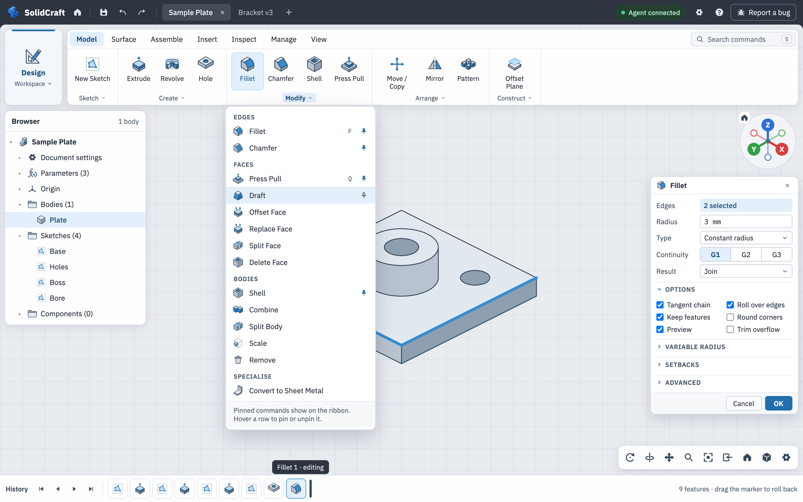
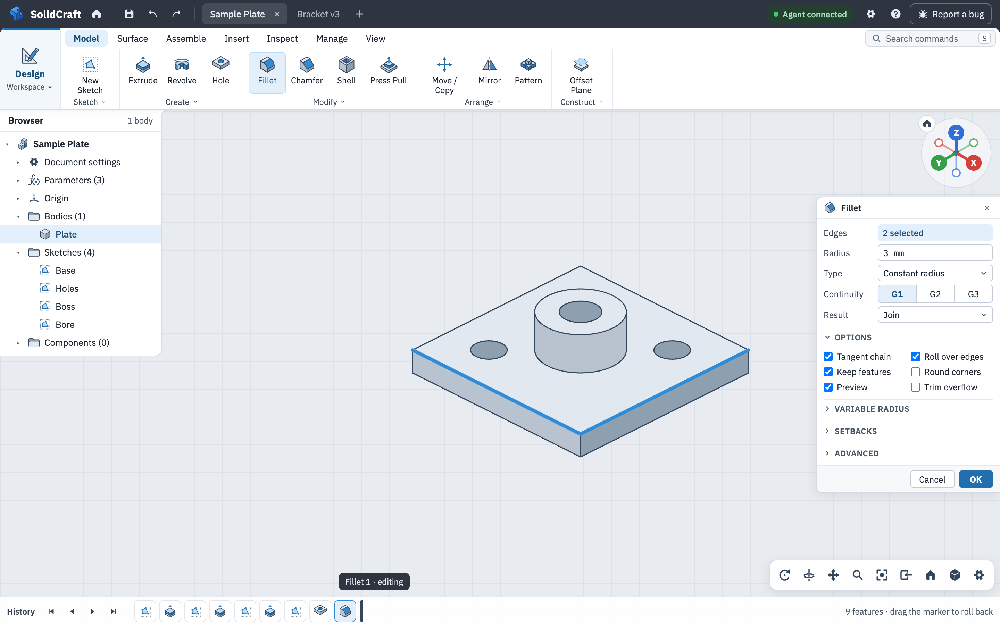

# UX redesign proposal: ribbon layout

Design mockups for a new desktop shell. They are pictures only: nothing in the app changes with
this proposal. The goal is a layout that is familiar to people coming from other CAD software and
easy for new users, built from standard patterns, with the current single-row toolbar replaced by
a ribbon whose tabs are ordered by task instead of by geometry type.

## The design

**Application bar** (dark): logo and name, a house icon that opens the start page, Save, Undo,
Redo, the design tabs (each with a close button), then the agent status, Settings, Help and
Report a bug. There is no search box here, no dark-mode toggle and no status bar.

**Ribbon**: a workspace card at the left (Design and Render), tabs **Model, Surface, Assemble, Insert, Inspect, Manage, View**, and a small command
search at the right end of the tab row (also the S key). Each section shows one to four promoted
commands. Its label (▾) opens a list of every command in the section, and hovering a row pins it
to the ribbon, as in the current app. Tooltips show the shortcut and modifier keys.

**Contextual tabs** appear when the design needs them and are selected automatically:
**Sketch** while a sketch is open (Create, Modify, Pattern, Constrain, Reference), **Sheet Metal** when the active body has a sheet-metal rule.
Nothing is greyed out, and the other tabs stay available. Plastic features live in
Model › Create ▾ and plastic rules in Manage, so there is no Plastic tab.

**Viewport and panels**: the viewport is full-bleed under the application bar. The view compass is
fixed at the top right and panels open below it. History is a full-width icon strip along the
bottom edge.

**Start page**: the house icon opens a full-page view with New, Open, Recent, Samples and crash
recovery; Save As and Export are there too. The camera's Home view stays in the navigation bar.

**Workspaces** are product modes that share the same design, history and selection and change only
the ribbon tabs. The geometry types (Solid, Surface, Mesh) are tabs, not workspaces. Only Design
and Render exist today and are the scope of this work; the switcher mockup also greys out the
entries the app's own workspace menu already lists as "coming later".

| Board | What it shows |
|---|---|
| [Command map](command-map.png) | All 389 commands regrouped by task, and where today's panels go |
| [Floating](model-floating.png) | Model tab with the ribbon, browser and dialog floating over the viewport, Modify list open |
| [Compact](model-compact.png) | The same tab docked to the window edges (see below) |
| [Sketch](sketch.png) | Sketch tab with Finish Sketch as its own ribbon group |
| [Sheet metal](sheet-metal.png) | The contextual tab opened on a sheet-metal body |
| [Start page](start-page.png) | The house icon's full-page view |
| [Workspaces](workspaces.png) | The workspace switcher, open |

## Options

**Floating** (above) keeps the ribbon, browser and dialogs as rounded cards over a full-bleed
viewport. It looks lighter and keeps the 3D view visible around every panel.

**Compact** docks the ribbon and the workspace card into one bar at the top with no gap, docks the
browser flush to the left edge and ribbon (concave corner where they meet, only as tall as its
contents), and docks a denser feature panel to the right edge below the compass. Spacing is a
little tighter throughout. It maximises viewport space and still looks finished.

Both options use the same dense feature panel: 24 px rows, a narrow label column, two-column
options and collapsed sections, so commands with 10 to 20 options fit.

## Not included

- The earlier sketch variant with tab locks and a Finish menu was set aside as too complex for a
  first version, and is not part of this proposal.
- The icons in the mockups are the reviewed SVGs from the icon system in PR #853
  (`assets/icons/ui/design/svg/`), coloured with its accents from `palette.toml`: Sketch tools in
  the Sketch green, constraints in red, everything else in the Solid blue. The greyed Simulation and
  Manufacture entries in the switcher mockup use placeholder icons and are not part of this work. This proposal does not
  implement or change any app icons.
